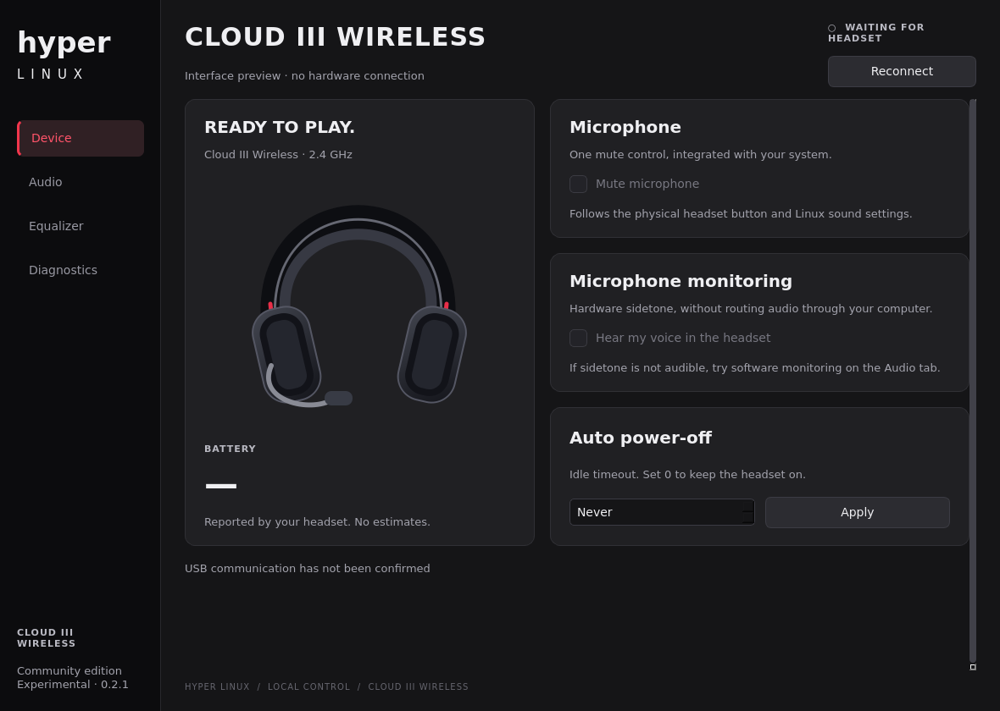

# Hyper Linux

[English](README.md) | **Português (Brasil)**

> [!IMPORTANT]
> **Todo este projeto foi vibecodado com assistência de IA.** O código foi construído de forma iterativa por meio de prompts, testes, depuração e refinamento, em vez de um fluxo tradicional de programação do zero.

Aplicativo nativo para controlar o **HyperX Cloud III Wireless** no Linux, feito com Qt 6, Python e PipeWire. Não depende de Wine, NGENUITY ou HyperHeadset.

**Estado:** experimental, testado no CachyOS com KDE Plasma e dongle `03f0:05b7`. Bateria, mute e retorno do microfone foram confirmados nos testes. A variante `03f0:0c9d` é reconhecida, mas ainda não foi testada em hardware aqui. A saída de áudio do equalizador precisa de mais validação. A interface do aplicativo e as capturas do repositório estão em inglês.

Projeto independente da comunidade, sem afiliação com HyperX ou HP. Usa ilustrações próprias e fontes do sistema. Não distribui logotipos, fotos de produtos, fontes, instaladores, DLLs ou firmware do fabricante.



## Recursos

- Bateria e carregamento consultados diretamente no dongle.
- Controle único de mute, acompanhando os eventos de áudio do Linux e do botão físico.
- Sidetone do fone e retorno separado pelo PipeWire, com volume ajustável.
- Desligamento automático, volume de saída e ganho do microfone.
- Equalizador por software com 10 bandas, frequência e Q ajustáveis, presets e perfis JSON.
- Diagnóstico local e registro de comandos USB, sem gravação de áudio.

## Baixar e instalar

Baixe o **AppImage** em [GitHub Releases](https://github.com/vitorioaugusto/hyper-linux/releases/latest). O AppImage é para **x86_64**, compilado em Ubuntu 22.04 (glibc 2.35). Outras arquiteturas ainda não têm pacotes.

### AppImage — incluindo Arch / CachyOS

Inclui Qt, Python e libusb. O sistema precisa de uma sessão **PipeWire com compatibilidade PulseAudio**, além dos comandos `pipewire` e `pactl`. No Arch / CachyOS, eles são fornecidos por `pipewire`, `pipewire-pulse` e `libpulse`.

```bash
chmod +x Hyper_Linux-0.2.2-x86_64.AppImage
./Hyper_Linux-0.2.2-x86_64.AppImage
```

Se a distribuição não conseguir montar AppImages com FUSE:

```bash
./Hyper_Linux-0.2.2-x86_64.AppImage --appimage-extract-and-run
```

O AppImage não instala regras USB nem altera os serviços de áudio. Veja **Permissão USB** abaixo, se necessário.

No Debian / Ubuntu, instale as ferramentas de áudio do sistema, se necessário:

```bash
sudo apt install pipewire pipewire-bin pipewire-pulse pulseaudio-utils
```

É necessária uma sessão PipeWire com compatibilidade PulseAudio ativa. Para adicionar o AppImage ao menu, use o Gear Lever ou a integração disponível no seu desktop.

Ainda não há RPM nem publicação no Flathub. As [notas de empacotamento](docs/packaging.md) descrevem as receitas, licenças das dependências e validação.

## Dependências para compilar

No Arch / CachyOS:

```bash
sudo pacman -S --needed gcc pkgconf qt6-base python pipewire pipewire-audio pipewire-pulse libpulse libusb
```

No Ubuntu / Debian:

```bash
sudo apt install g++ pkg-config qt6-base-dev python3 pipewire pipewire-bin pipewire-pulse pulseaudio-utils libusb-1.0-0
```

É necessário conectar o dongle e ligar o fone para usar os controles de hardware.

## Compilar e abrir

```bash
git clone https://github.com/vitorioaugusto/hyper-linux.git
cd hyper-linux
bash build.sh
bash run.sh
```

Execute como usuário normal do desktop, sem `sudo`. Feche outros aplicativos de controle do fone durante os testes.

### Instalar no seu usuário

```bash
bash install.sh
```

Instala em `~/.local/share/hyper-linux`, cria o launcher em `~/.local/bin` e adiciona **Hyper Linux** ao menu de aplicativos. Respeita `XDG_DATA_HOME`. Não instala dependências nem altera os serviços de áudio do sistema.

### Permissão USB, se necessária

Caso o diagnóstico indique acesso negado a `/dev/hidraw*`:

```bash
# Baixe a regra específica do dispositivo ao usar o AppImage.
curl -fLO https://raw.githubusercontent.com/vitorioaugusto/hyper-linux/main/udev/70-hyper-linux.rules
sudo install -m644 70-hyper-linux.rules /etc/udev/rules.d/70-hyper-linux.rules
sudo udevadm control --reload-rules
```

Desconecte e reconecte o dongle. As regras concedem acesso ao usuário local ativo; o aplicativo continua sendo executado sem `sudo`.

## Retorno do microfone

Em **Device**, ative **Hear my voice in the headset** para usar o sidetone de hardware. Se não ouvir o retorno, desligue essa opção e teste **Audio → Enable software monitoring**. Comece em 25% e use somente uma modalidade por vez para evitar eco.

O retorno por software solicita 10 ms ao PipeWire; a latência final depende do computador e do fone e não foi medida. Fechar o app encerra os processos de retorno e equalização criados por ele.

## Equalizador

Selecione a saída física do fone em **Audio** e ative o efeito em **Equalizer**. Nas configurações de som do desktop, escolha **Hyper Linux · Equalizer** como saída. O aplicativo não troca o dispositivo padrão automaticamente.

As bandas positivas aplicam uma margem conservadora para reduzir distorção, podendo diminuir o volume geral. Os perfis usam o formato JSON `hyper-linux-eq-v1`. O efeito é processado no Linux e não fica salvo na memória do fone.

## Limitações

- Sem DTS/SONAMI, processamento proprietário de voz por IA ou atualização de firmware.
- Não presume compatibilidade com o Cloud III S nem com o Cloud III com fio.
- Sem ajuste de nível do sidetone ou EQ embarcado no Cloud III Wireless original.
- Aplicar edições no EQ recria o nó do filtro; pode ser necessário selecionar novamente sua saída.

## Diagnóstico e testes

```bash
./hyper-linux --diagnose
python3 -m unittest -v test_backend
QT_QPA_PLATFORM=offscreen ./hyper-linux --preview --smoke-test
```

O diagnóstico faz somente consultas. Os logs ficam em `~/.local/state/hyper-linux`, respeitando `XDG_STATE_HOME`. Revise os arquivos antes de anexá-los a uma issue: podem conter identificadores locais de dispositivos e caminhos de arquivos. Informe distribuição, desktop, ID USB do dongle e o comportamento observado.

Outras capturas, em inglês: [Audio](docs/audio.png) · [Equalizer](docs/equalizer.png).

Os [detalhes do protocolo](docs/protocol.md) descrevem os pacotes e a confirmação dos comandos.

## Licença

O código e a arte original usam a [licença MIT](LICENSE). Qt e outras dependências mantêm suas próprias licenças. O AppImage inclui os avisos de terceiros em `usr/share/licenses/hyper-linux` dentro do conteúdo extraído. Os nomes dos produtos identificam o hardware compatível.
